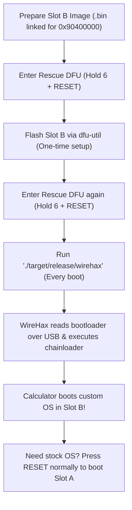

# WireHax

>[!WARNING]
>Wirehax was patched in Epsilon 26.4.0. Upgrading to 26.4.0 will
>permanently lock your calculator.

>[!IMPORTANT]
>**Independent Project & Educational Use Only**  
>WireHax is an independent open-source research project not affiliated with NumWorks SAS.
>This repository contains **no proprietary NumWorks firmware or binaries**.
>WireHax is intended strictly for security research, hardware interoperability, and educational purposes.
>Do not use this tool to bypass examination locks or violate academic integrity policies.
>For full trademark notices, copyright policies, and liability disclaimers, please read [`LEGAL.md`](LEGAL.md).

WireHax boots a modified NumWorks N0120 Slot B image through the rescue-DFU
ROP/RCE path using a single standalone executable.

The boot is temporary: WireHax stages its ROP chain and chainloader in RAM,
then branches to the external Slot B image. It does not replace the bootloader
or write to internal flash.

---

## Understanding the Architecture: Slot A vs. Slot B

NumWorks N0120 calculators divide their storage into distinct regions:

- **Internal Flash (`0x08000000`):** Contains the 512 KiB read-only bootloader.
- **External QSPI Flash (`0x90000000`):** Divided into two operating system partitions:
  - **Slot A (`0x90000000`):** The default slot containing the factory-installed, signed NumWorks Epsilon OS.
  - **Slot B (`0x90400000`):** A secondary partition normally reserved for OS upgrades.

### Why This Is Safe & Non-Destructive

* **Slot A is left untouched:** WireHax only writes its payload to RAM and instructs the calculator to jump to Slot B (`0x90400020`). Your official, signed OS in Slot A remains intact.
* **Non-persistent:** WireHax runs purely in volatile SRAM. If anything hangs or fails, simply press the rear **RESET** button without holding any keys. The calculator immediately reverts to running stock Epsilon from Slot A.

---

## Requirements

- NumWorks N0120 running Epsilon $\le$ 26.3.0 (not upgraded to 26.4.0+).
- Rust toolchain (1.85+ / 2024 edition) if building from source.
- `dfu-util` (to flash your custom Slot B image).
- USB access for device `0483:a291`.
- A custom Slot B raw binary image linked for `0x90400000` *(Note: A ready-to-flash Slot B example/guide will be added later)*.

### Install `dfu-util`

`dfu-util` is required to write custom images to external flash Slot B:

* **Linux (Debian/Ubuntu):** `sudo apt install dfu-util`
* **Linux (Arch):** `sudo pacman -S dfu-util`
* **macOS (Homebrew):** `brew install dfu-util`
* **Windows:** Install via [Scoop](https://scoop.sh/) (`scoop install dfu-util`) or download the precompiled binary from [SourceForge](https://sourceforge.net/projects/dfu-util/files/).

### USB Setup & Drivers

#### Linux: udev Rules
On Linux, accessing USB device `0483:a291` requires non-root permissions. Install the bundled udev rule:

```sh
sudo cp 50-numworks.rules /etc/udev/rules.d/
sudo udevadm control --reload-rules && sudo udevadm trigger
```

#### Windows: WinUSB Driver (Zadig)
On Windows, WireHax and `dfu-util` communicate with the STM32 DFU bootloader via `libusb`/`WinUSB`. If your calculator is not detected or throws connection errors:
1. Put the calculator into **Rescue DFU** mode (Hold **6** + press **RESET**).
2. Download and run [Zadig](https://zadig.akeo.ie/).
3. In Options, check **List All Devices**.
4. Select `STM32 BOOTLOADER` (USB ID `0483:a291`).
5. Select **WinUSB** as the driver and click **Replace Driver** (or **Install Driver**).

## End-to-End Workflow

Here is the complete order of operations from zero to booting a custom OS:



1. **Obtain/Build Slot B Firmware:** Compile or obtain a raw binary firmware (such as Omega, Upsilon, or a custom Epsilon build) linked to run at base address `0x90400000`.
   *(Note: A pre-built Slot B sample image and dedicated build guide will be added in a future update).*
2. **Flash Slot B (One-time):** Put the calculator in rescue DFU, then flash the binary to `0x90400000` using `dfu-util`.
3. **Boot via WireHax (Every boot):** Put the calculator in rescue DFU, then run `wirehax`. WireHax will inspect the bootloader over USB on the fly and trigger the ROP boot.
4. **Return to Stock:** Press the rear **RESET** button without holding any keys. The calculator reboots back into the official stock OS in Slot A.

---

## Setup & Build

>[!TIP]
>If you just want to run WireHax on your calculator, you can skip building
>from source and grab a binary from the releases page instead.

Build the standalone binary using Cargo:

```sh
# On Debian/Ubuntu install build dependencies if building from source:
# sudo apt install libudev-dev pkg-config

cargo build --release
```

The resulting binary is located at `target/release/wirehax` (or `target/release/wirehax.exe` on Windows).

---

## CLI Usage & Commands

```text
Usage: wirehax [OPTIONS] [COMMAND]

Commands:
  boot        Boot modified Slot B image (default)
  self-check  Verify bundled assets and ROP layout against a firmware dump
  dump        Dump internal flash memory over USB DFU
  version     Check NumWorks N0120 Epsilon OS version

Options:
  --self-check           Verify bundled assets and ROP layout
  --firmware <PATH>      Path to custom internal flash dump
  --save-dump            Save live flash dump
  -h, --help             Print help
```

### Normal Boot: Do You Need a Local Firmware Dump?

**No.** For normal operation, you do **not** need to provide or locate any firmware dump files.
When you run:

```sh
./target/release/wirehax
```

WireHax connects to the calculator over USB, automatically dumps the internal flash bootloader into memory to identify the model and gadgets, and stages the exploit on the fly.

> The `--firmware <path>` option is purely an optional performance shortcut: if you already dumped your flash previously, passing `--firmware firmware/internal-flash-live.bin` skips reading flash over USB and boots faster.

### Self-Check (Why It Fails Out of the Box)

If you run `wirehax self-check` on a fresh repository clone:

```sh
./target/release/wirehax self-check
```

You will see:

```text
Error: Self-check requires a firmware binary. Dump one with wirehax dump or supply one with --firmware <path>.
```

**Why this happens:** WireHax intentionally does not bundle proprietary NumWorks bootloader binaries in the Git repository (`firmware/` is excluded). The `self-check` command needs a real firmware binary to test symbol extraction and gadget resolution.

To use `self-check`:
1. Connect your calculator in rescue DFU.
2. Dump your bootloader once:
   ```sh
   ./target/release/wirehax dump
   ```
   (This saves your calculator's flash to `firmware/internal-flash-live.bin`).
3. Now run self-check:
   ```sh
   ./target/release/wirehax self-check
   ```
   Output:
   ```text
   Self-check: inspecting bootloader hash and selecting codebase...
     Detected bootloader: ...
   Self-check [bootloader codebase]: resolving symbols and validating stage layout...
   SELF_CHECK_OK
   ```

### Dumping Flash

WireHax can dump internal flash memory over USB DFU:

```sh
./target/release/wirehax dump [-o <output>] [-s <size>] [-a <address>] [-A <alt>]
```

- `-o, --output <PATH>`: Destination file (defaults to `firmware/internal-flash-live.bin`).
- `-s, --size <SIZE>`: Size to dump in bytes or hex (defaults to `0x80000` / 512 KiB).
- `-a, --address <ADDR>`: Flash base address (defaults to `0x08000000`).
- `-A, --alt <ALT>`: DFU interface alternate setting (defaults to `0`).

### Checking Epsilon OS Version

Inspect Epsilon OS slot headers (`0xDEC00DF0`) to confirm version compatibility:

```sh
# Check connected calculator over USB
./target/release/wirehax version

# Check specific slots (a, b, or all)
./target/release/wirehax version --slot b

# Check a local slot firmware binary
./target/release/wirehax version -f path/to/slot-b.bin

# Validate against specific supported versions
./target/release/wirehax version --supported 26.1.0,26.3.0
```

---

## Prepare the Calculator

Enter rescue DFU before every boot attempt:

1. Hold **6**.
2. Press and release the rear **RESET** button.
3. Release **6**.

The calculator should remain on the rescue DFU screen and appear as USB device
`0483:a291` on your PC.

### Flashing Slot B (One-Time Setup)

If you haven't flashed your custom Slot B image yet, write it using `dfu-util`:

```sh
dfu-util -a 0 -s 0x90400000 -D path/to/your_slot_b_file.bin
```

>[!NOTE]
>This command only overwrites the secondary external Slot B sector. It does not touch Slot A or internal flash.

---

## Booting

With the calculator in rescue DFU, run:

```sh
./target/release/wirehax
```

WireHax will:
1. Connect to the rescue DFU device (`0483:a291`).
2. Read internal flash to compute its SHA-256 hash.
3. Select the appropriate exploit implementation (`v20_24` or `v24_26`) or probe dynamically if unknown.
4. Dynamically locate ROP gadgets and vtables using Thumb-2 byte signature scanning.
5. Perform the calibration pass and stage the chainloader in SRAM.
6. Trigger the ROP chain.

The tool prints `BOOT_ATTEMPT_SENT` after handing control to the SRAM chainloader.

The final DFU request can report `DFU_DISCONNECT_EXPECTED`. This is normal: the
calculator has already left DFU and started the chainloader before the host
receives the USB acknowledgement. Continue if the calculator displays the
modified firmware.

---

## Auxiliary Scripts in `patches/`

The `patches/` folder contains Python utility scripts used when modifying or preparing custom firmware images:

### 1. `patches/dont_verify_kernel_signature.py`
* **What it does:** The Numworks bootloader checks if a slot (A or B) was signed by them before booting it, and won't boot it if it wasn't. This script finds the check and replaces it with `01 20 70 47` (`movs r0, #1; bx lr`). This forces the signature verification to always succeed (`true`).
* **When you need it:** If you are modifying an existing Epsilon bootloader binary and want to permanently boot a custom userland in slot A.
* **Usage:** Listed in the file itself.

### 2. `patches/nop_option_bytes.py`
* **What it does:** Scans a binary for the routine that programs STM32 option bytes (specifically setting RDP level 1 and WRP flash write protection) and overwrites it with 28 bytes of NOP instructions (`00 bf`).
* **When you need it:** Stock Epsilon firmware (both bootloader and kernel) contains routines designed to lock down internal flash and disable SWD/JTAG hardware debugging by blowing hardware option bytes. Running this patch prevents the firmware from permanently locking down the microcontroller's hardware debug features.
* **Usage:** Listed in the file itself.

---

## Bootloader Overwrite

A bare-metal C++ firmware application located in [`examples/overwrite_bootloader/`](examples/overwrite_bootloader/README.md) designed to be booted into Slot B (`0x90400000`) via WireHax.

* **What it does:** It checks STM32H7 internal flash write-protection status (WRP) and can erase, flash, and verify an embedded replacement bootloader image at `0x08000000`.
* **Risk & Prerequisites:**
   >[!CAUTION]
   >**HIGH BRICK RISK:**
   >Overwriting internal flash (`0x08000000`) is an advanced research and recovery procedure.
   >If the sector erase succeeds but writing fails, or if the supplied bootloader binary is invalid or corrupt,
   >**your calculator will be hard-bricked** and unable to boot into either regular mode or rescue DFU.
   >
   >Do **NOT** run this utility unless you have access to an external hardware ST-Link / SWD debugger and have verified your ability to recover the device.
* **Documentation & Usage:** See the dedicated guide in [examples/overwrite_bootloader/README.md](examples/overwrite_bootloader/README.md).

---

## How It Works

### Dynamic Resolution & Dual Bootloader Support

The original WireHax by [Andrei](https://github.com/andr3i1010) relied on static
gadget addresses for a single firmware build. This version supports two distinct
bootloader architectural families and dynamically resolves gadget addresses,
callbacks, and vtables at runtime using Thumb-2 byte signature scanning
([`src/sigscan.rs`](src/sigscan.rs) and [`src/boot/v24_26.rs`](src/boot/v24_26.rs)):

1. **Legacy Bootloaders (`v20_24`)**: Covers Epsilon 20.4.0 through 24.1.0.
   - Setter offset: `0x824`
   - Word-store primitive: `str r2, [r0]; bx lr`
   - ROP marker: `STAGE + 0xc0` (`0x240100c0`)
   - Overflow payload size: `0x93c` bytes (offset `0x938`, vtable at `0x800`)
   - Vtable derivation: `dynamic_vtable = root - 0x138`, `callback_sp = root - 0x9bc`

2. **Modern Bootloaders (`v24_26`)**: Covers Epsilon 24.2.0 through 26.3.0.
   - Setter offset: `0x820`
   - Word-store primitive: `str r0, [r4]; pop {r4, pc}`
   - ROP marker: `STAGE + 0x1b0` (`0x240101b0`)
   - Overflow payload size: `0x8fc` or `0x904` bytes (offset `0x8f8` or `0x900`, vtable at `0x700`)
   - Vtable derivation: `dynamic_vtable = root - (overflow_offset - 0x700)`, `callback_sp = root - (overflow_offset + 0x18)`
   - Dynamically resolves between `+8` and `+12` vtable candidate layouts.

If a bootloader's SHA-256 hash is not recognized in [`src/bootloader.rs`](src/bootloader.rs), WireHax
automatically probes both fallback signature models against the flash dump.

### Address Map

The tool treats the rescue DFU RAM window as a 252 KiB region beginning at
`0x24000000` (`RAM_SIZE = 0x3f000`):

| Symbol | Address | Purpose |
| --- | ---: | --- |
| `BASE` | `0x24000000` | Start of the readable/writable DFU RAM window |
| `FAKE_VTABLE` | `0x24000080` | Temporary vtable used by the probe |
| `STAGE` | `0x24010000` | 512-byte ROP stage |
| `MARKER` (`v20_24`) | `0x240100c0` | Execution marker written by the first `memmove` (`0xd00dfeed`) |
| `MARKER` (`v24_26`) | `0x240101b0` | Execution marker for modern bootloader builds |
| `SRAM_MARKER` | `0x240101f0` | Chainloader marker (`XIP!` / `0x58495021`) |
| `SRAM_CODE` | `0x24010200` | Thumb entry of decrypted `xip-chainloader.bin` |
| `SRAM_STACK` | `0x24010300` | Stack pointer selected when the ROP chain pivots into SRAM |
| `WARM` | `0x2401f000` | DFU download address used for overflow payloads |
| `MPU_CTRL` | `0xe000ed94` | Cortex-M MPU control register |
| `MPU_RNR` | `0xe000ed98` | Cortex-M MPU region selector |
| `MPU_RBAR` | `0xe000ed9c` | Cortex-M MPU region base register |
| `MPU_RASR` | `0xe000eda0` | Cortex-M MPU region attributes/size register |
| Slot B vector table | `0x90400020` | External XIP address containing initial MSP and reset handler |

### USB DFU Primitives

WireHax communicates directly with the ST DFU protocol stack via USB control transfers:

| Operation | `bmRequestType` | `bRequest` | Important arguments |
| --- | ---: | ---: | --- |
| Select alternate setting | `0x01` | `11` | `wValue = alt` |
| Read status | `0xa1` | `3` | 6-byte status response (`status`, `poll_timeout`, `state`) |
| Set address | `0x21` | `1` | block `0`, payload `0x21 || uint32(address)` |
| Download RAM data | `0x21` | `1` | block `2`, up to 2048 bytes |
| Upload RAM data | `0xa1` | `2` | block `2+N`, up to 2048 bytes |
| Abort transfer | `0x21` | `6` | resets DFU transfer state |

Writes are chunked into 2048-byte blocks (`TRANSFER`). Reads set the address,
abort into the upload state, stream sequential 2048-byte blocks, and abort back
to idle. Status delays are honored on every transfer.

### Phase 1: Discover the Live Callback Root

The first overflow is a calibration pass. The stack and object addresses
vary between runs, so WireHax locates them dynamically from RAM state changes:

1. It reads the complete RAM window at `0x24000000` (`before`).
2. It writes a copy of the stock vtable to `FAKE_VTABLE = 0x24000080` and verifies readback.
3. It constructs an overflow payload containing the `FAKE_VTABLE` pointer at the target overflow offset.
4. It sets the DFU address to `WARM = 0x2401f000` and downloads the payload.
5. It sends a trigger request (alternate setting with `wValue = 0x5a`), which causes the stock byte-setter callback to write `0x5a` into the calibration target.
6. It reads the RAM window again (`after`).

`fake_hits()` scans word-aligned offsets in `after` for references to `FAKE_VTABLE`.
It checks `offset + setter_offset` (`0x824` on `v20_24`, `0x820` on `v24_26`) and identifies the single root where:

```text
before[root_offset + setter_offset] != 0x5a
after[root_offset + setter_offset]  == 0x5a
```

From this live `root`, WireHax calculates `dynamic_vtable` and `callback_sp` precisely for this run.

### Phase 2: Construct the ROP Stage

`build_stage()` creates a 512-byte (`0x200`) ROP sequence at `STAGE`:

1. **Write the first marker:** Calls the `memmove` primitive to write `0xd00dfeed` into `MARKER`, establishing an execution milestone.
2. **Restore the stock callback:** Copies the original callback address over the temporary entry in `dynamic_vtable`.
3. **Select MPU Region 2:** Invokes the stock byte setter targeting `MPU_RNR` (writing `2` to `0xe000ed98`).
4. **Make SRAM executable:** Uses the word-store primitive to write `0x010b0039` to `MPU_RASR` (`0xe000eda0`), disabling XN (eXecute-Never) on the SRAM region.
5. **Pivot into SRAM:** Invokes the stack pivot gadget pointing to a table containing:
   - `SRAM_STACK` = `0x24010300`
   - `SRAM_CODE | 1` = `0x24010201` (Thumb mode)

Control transfers into the chainloader in SRAM.

### Phase 3: Enter the ROP Stage

WireHax writes and verifies the following in SRAM:
- Zeroed 4-byte `MARKER`
- Zeroed 4-byte `SRAM_MARKER`
- Decrypted chainloader payload at `SRAM_CODE`
- Staged ROP payload at `STAGE`

It then downloads the final overflow payload to `WARM` (with embedded vtable, pivot pointers, and `dynamic_vtable`), followed by the final DFU trigger. The DFU callback stack pivots into `STAGE`, which pivots into SRAM.

### Phase 4: The SRAM Chainloader

The bundled chainloader ([`payloads/xip-chainloader.s`](payloads/xip-chainloader.s)) executes in SRAM:

```asm
cpsid i                         ; disable interrupts during MPU configuration
ldr  r3, [marker_addr]
ldr  r2, [marker_value]
str  r2, [r3]                   ; *(0x240101f0) = 0x58495021 ("XIP!")

ldr  r3, [mpu_ctrl_addr]
movs r2, #0
str  r2, [r3]                   ; MPU_CTRL = 0
dsb  sy

MPU_RNR  = 6
MPU_RBAR = 0x90000000
MPU_RASR = 0x0102002d           ; enable execution for external Slot B XIP mapping
MPU_CTRL = 1
dsb  sy
isb

cpsie i                         ; restore interrupts

r0 = 0x90400020
r1 = [r0]                       ; Slot B initial MSP
r2 = [r0 + 4]                   ; Slot B reset handler
MSP = r1
bx   r2                         ; branch to Slot B reset handler in Thumb state
```

The chainloader records the `XIP!` marker, configures MPU region 6 to allow
execution over external flash at `0x90000000`, loads the main stack pointer from
Slot B vector table `0x90400020`, and jumps directly to its reset handler.

---

## Troubleshooting

- **`rescue DFU device 0483:a291 not found`**:
  The calculator is not in rescue DFU, the USB cable is disconnected/power-only, or the user lacks USB permissions.
- **`USB access to rescue DFU was denied`**:
  On Linux, non-root USB access requires udev rules. Run `sudo cp 50-numworks.rules /etc/udev/rules.d/ && sudo udevadm control --reload-rules && sudo udevadm trigger`.
  On Windows, ensure the WinUSB driver is assigned to `0483:a291` using [Zadig](https://zadig.akeo.ie/).
- **`USB device is not responding as rescue DFU` / `DFU is not idle`**:
  The device did not answer DFU requests or is in a busy state. Reset the calculator (rear RESET) and re-enter rescue DFU with **6** + **RESET**.
- **`Self-check requires a firmware binary`**:
  Dump your internal flash first using `wirehax dump`, or provide an existing dump via `--firmware <path>`.
- **`Target bootloader has an UNSUPPORTED hash`**:
  The calculator's bootloader version has been patched (Epsilon 26.4.0 or later) and cannot be exploited with WireHax.

---

## Credits & Acknowledgments

- **[Andrei](https://github.com/andr3i1010)**: Creator of the original Wirehax, who discovered the rescue DFU ROP/RCE vulnerability, proved the initial concept, and laid the groundwork for booting custom firmware on the N0120.
- **[Bjarnos](https://github.com/Bjarnos)**: Architecture redesign, Thumb-2 dynamic signature scanning, dual bootloader family support (`v20_24` & `v24_26`), and standalone CLI tooling.
